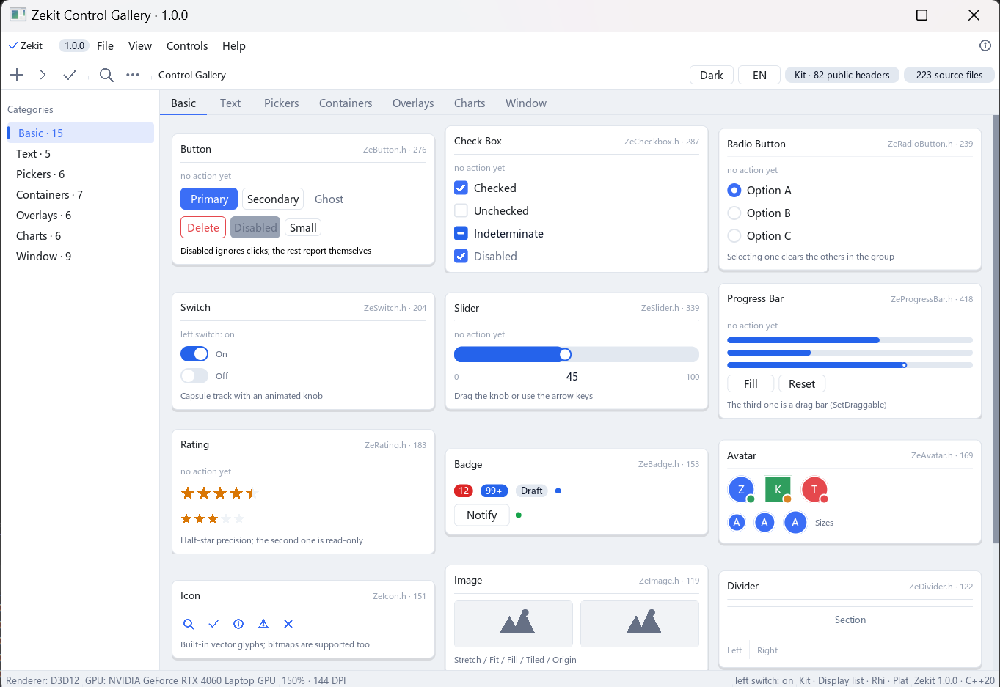

# Zekit

A self-contained C++20 desktop GUI toolkit for Windows and Linux.

Window creation, message loop, GPU rendering, widgets, layout, text and IME are all
in one static library. Downstream projects link a single file — no FreeType install,
no Vulkan SDK, no third-party setup.



*Control Gallery — every widget in the library, in one window. Ships in `examples/gallery`.*

---

## Highlights

- **Value-semantic widget tree.** Widgets are plain values: build them on the stack,
  hand them to the window with `win.AddWidget(btn)`, done. No `new`, no `delete`,
  no keeping a member alive. Destruction unregisters automatically.
- **GPU rendering, three backends.** Windows defaults to D3D12 (auto-falls back to
  OpenGL 4.6 Core) and can switch to Vulkan 1.0+. Linux runs OpenGL (EGL) or Vulkan.
  All backends share the same widget layer and display list, so the same UI looks the
  same everywhere. The backend is chosen per window: `win.UseRenderer(Rhi::Api::Vulkan)`.
- **Arbitrary shapes.** Rounded rectangles, strokes, shadows, alpha, plus circle, arc,
  line, polygon, Bezier and Catmull-Rom primitives.
- **Layout system.** VBox, HBox, Grid and Flow containers with flex-style properties
  (`flexGrow`, `alignSelf`, margin, min/max size), or manual positioning. Layout
  containers *are* widgets — there is no separate layout object to mount.
- **Text and fonts.** FreeType rasterization, UTF-8 safe end to end, surrogate pairs
  and emoji included. The font renderer does not depend on any graphics API.
- **Real IME support.** Full IMM32 integration: composition drawn in place,
  candidate window following the caret, de-duplicated commits.
- **Theme system.** Light and dark, six-state colors per slot
  (Normal / Hover / Pressed / Focused / Disabled / Loading), every slot overridable,
  optional follow-system-dark-mode.
- **Multi-window.** Any number of windows, one `exec()` drives them all.
- **Uniform callback protocol.** Every `SetOnXxx` comes in two flavors: no-arg, and
  one that receives the sender as `Widget&`. The latter needs no captures, which
  sidesteps the move semantics of value widgets entirely.
- **Addressable widgets.** `objectName` for stable identity, plus `FindWidget<T>`,
  `FindWidgetDeep<T>`, `FindAll<T>` and `VisitTree`.

## Architecture

Three layers, dependency direction fixed at compile time:

```
Kit      widget tree / layout / theme / event dispatch / focus     platform-agnostic, one copy
 │
 ├─ Plat  IWindow: window / message pump / input translation / IME / clipboard
 │        Win32, X11
 │
 └─ Rhi   IBackend: Init / DrawFrame / Resize / Shutdown
          OpenGL, Vulkan, D3D12, EGL
```

Two rules make the portability real rather than aspirational:

1. Platform code is selected with compile-time branches, never run-time `if`.
   Compiling `#include <windows.h>` on Linux must fail the build, not the process.
2. `Plat` never knows about `Kit`. It depends only on the `IWindowHost` interface,
   which `Kit` implements.

Adding a platform means adding one `IWindow` implementation and one line in the
build list. The widget layer does not change.

## Requirements

| | |
|---|---|
| Compiler | MSVC 19.3x (VS 2022 / 2026) or GCC 11+ / Clang 14+ |
| Standard | C++20 |
| Build | CMake ≥ 3.22 |
| Linux packages | `libx11-dev libgl-dev libegl-dev pkg-config` |

Vulkan and D3D12 are loaded at run time; no SDK is needed to build or to run.

## Build

### Windows

Open a normal terminal in the repository root. Pick the preset matching your
Visual Studio:

```bat
:: Visual Studio 2026
cmake --preset windows-msvc
cmake --build --preset windows-msvc-release

:: Visual Studio 2022
cmake --preset windows-vs2022
cmake --build --preset windows-vs2022-release
```

Output: `x64\Release\Zekit.lib` (Debug goes to `x64\Debug\`).

Prefer Ninja? Run from a *Developer Command Prompt* (so `cl.exe` is on `PATH`):

```bat
cmake --preset windows-ninja
cmake --build --preset windows-ninja
```

**Single-file executables.** By default the library uses the dynamic CRT (`/MD`).
If you ship a tool that must start on a machine without the VC++ runtime, build the
static-CRT variant — it lands in a separate directory so the two can never be mixed:

```bat
cmake --preset windows-msvc-mt
cmake --build --preset windows-msvc-mt-release     :: -> x64\ReleaseMT\Zekit.lib
```

### Linux

```bash
sudo apt install build-essential cmake libx11-dev libgl-dev libegl-dev pkg-config

cmake --preset linux-release
cmake --build --preset linux-release -j
```

Output: `build/linux-release/libZekit.a`.

Vulkan is `dlopen`ed at run time, so a machine without a Vulkan driver still runs
on OpenGL instead of failing to start.

### Using the library from another project

```cmake
# As a subdirectory
add_subdirectory(path/to/Zekit)
target_link_libraries(my_app PRIVATE zekit::zekit)

# Or install it once and find_package it
#   cmake --install build/msvc --config Release --prefix C:/libs/zekit
find_package(Zekit REQUIRED)
target_link_libraries(my_app PRIVATE zekit::zekit)
```

`zekit` links its platform libraries as `PUBLIC`, so you inherit `user32`, `d3d12`,
X11 and friends automatically.

### Building the examples

The gallery is **not** built by default — a plain `cmake --preset windows-msvc`
gives you `Zekit.lib` and nothing else. Pass the option to get the program:

```bat
cmake --preset windows-msvc -DZEKIT_BUILD_EXAMPLES=ON
cmake --build --preset windows-msvc-release
```

Or configure the example on its own; it pulls the library in as a subdirectory,
so nothing has to be built beforehand:

```bash
cmake -S examples/gallery -B build/gallery
cmake --build build/gallery -j
```

Either way the executable lands in **`<build>/bin/ZekitGallery.exe`** — the same
place for every generator, with no per-configuration subdirectory:

| Build directory used | Executable |
|---|---|
| `build/msvc` (preset) | `build/msvc/bin/ZekitGallery.exe` |
| `build/gallery` (standalone) | `build/gallery/bin/ZekitGallery.exe` |

CMake prints the exact path at the end of the configure step:

```
--   library : .../Zekit/x64/<Config>/Zekit.lib
--   gallery : .../build/msvc/bin/ZekitGallery.exe
```

If you configure without the option you get a reminder instead:

```
-- Examples are NOT built. For the Control Gallery, configure with -DZEKIT_BUILD_EXAMPLES=ON
```

### When nothing appears

Zekit creates its window and loads the GPU driver at run time. When something is
missing, the symptom is almost always **a process that starts and exits immediately
— no window, no dialog, no error**. Two causes cover nearly every case.

**1. The VC++ runtime is missing.** A default `/MD` build imports `VCRUNTIME140.dll`
and `MSVCP140.dll`. On a machine without the VC++ 2015–2022 redistributable, Windows
kills the process before `main` runs: nothing is printed, nothing is shown. If you
are handing an exe to someone else, build the static-CRT variant:

```bat
cmake --preset windows-msvc-mt -DZEKIT_BUILD_EXAMPLES=ON
cmake --build --preset windows-msvc-mt-release
```

Check what a binary actually needs:

```bat
dumpbin /dependents ZekitGallery.exe
```

A releasable exe lists only system DLLs (`USER32`, `D3D12`, `OPENGL32` …). If you
see `VCRUNTIME140.dll` or `MSVCP140.dll`, it will not start on a clean machine.

**2. The window never got created** (no GPU driver, remote session, an unusable
DISPLAY). The library falls back D3D12 → OpenGL → Vulkan, and if every backend
fails there is no window to show. Start it with a console attached to see what the
library reports:

```bat
set ZEKIT_CONSOLE=1
ZekitGallery.exe
```

On Linux, run it from a terminal — `main()` already has a console there, so any
diagnostic prints straight to stdout.

A third, rarer case: running the exe from a network share or a directory the process
cannot write to, which breaks the shader cache. Copy it to a local disk first.

## Quick start

```cpp
#include <Zekit.h>
#include <ZeButton.h>

int main() {
    Kit::Window win;

    Kit::Button btn("OK");
    btn.SetPosition(50, 50);
    btn.SetSize(220, 60);
    btn.SetOnClick([] { /* ... */ });
    win.AddWidget(btn);          // handed over; the local can die at end of scope

    win.Show();
    return win.exec();           // message + render loop, returns when the window closes
}
```

`int main()` produces a console subsystem binary. To get a windowed application
(no console window on Windows) from the same source on every platform, use
`ZEKIT_APP_ENTRY` from `<ZekitApp.h>`:

```cpp
#include <ZekitApp.h>

ZEKIT_APP_ENTRY(myApp) {
    Kit::Window win;
    win.Show();
    return win.exec();
}
```

## Documentation

The manual — architecture notes, per-widget reference, layout and theme guides —
ships as **Zekit Guide**, a standalone offline reader attached to every
[release](../../releases). Download, unpack, run. No server, no network.

> The manual is written in Chinese, with English code samples throughout.
> An English edition is in progress.

## Repository layout

```
Zekit/
├── CMakeLists.txt          single build entry for every platform
├── CMakePresets.json       ready-made presets (VS 2022 / 2026, Ninja, GCC)
├── cmake/
│   └── ZekitSources.cmake  the one and only source list
├── Zekit/
│   ├── include/            public headers — the only directory you need on the include path
│   ├── *.cpp / *.h         implementation (Plat / Kit / Rhi)
│   ├── third_party/        FreeType 2.14.1 sources (compiled into the library)
│   └── shaders/            Metal shader source (kept for the Apple port)
├── inc/                    third-party headers: Vulkan, GLM, SOIL2, glad
├── examples/gallery/       the Control Gallery shown above
└── assets/                 screenshots
```

## Platform support

| Platform | Status | Notes |
|---|---|---|
| Windows 10/11 x64 | **Primary** | D3D12, OpenGL 4.6, Vulkan 1.0+ |
| Linux x64 | **Supported** | OpenGL via EGL, Vulkan; X11 only (no Wayland yet) |
| macOS / iOS | Source exists, never compiled on real hardware | Metal backend written but unverified |
| Android | Source exists, last validated on an emulator | Mouse input on 2-in-1 devices unsolved |
| HarmonyOS | Source exists | Emulator only, not released |

Only Windows and Linux are released and supported. The other ports are in the tree
because the layering made them cheap to write, but they are not offered as working
targets.

## License

MIT — see [LICENSE](LICENSE).

Bundled third-party code keeps its own license. See
[THIRD_PARTY_NOTICES.md](THIRD_PARTY_NOTICES.md) before redistributing binaries.
