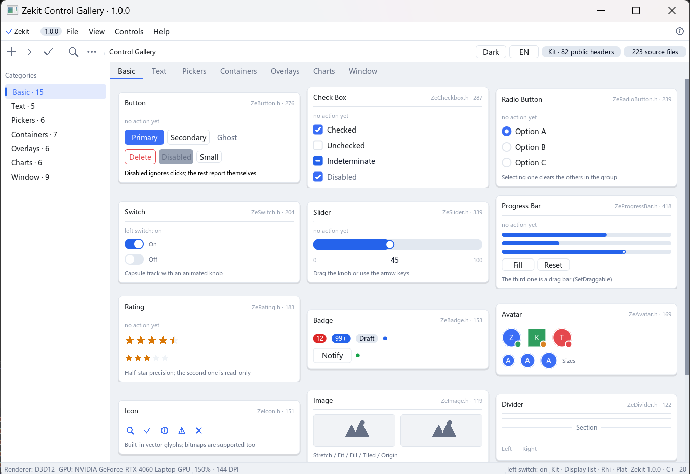

# Zekit

面向 Windows 与 Linux 的 C++20 桌面 GUI 控件库。

窗口、消息循环、GPU 渲染、控件、布局、文字与输入法全部收在一个静态库里，下游链接**一个文件**即可 ——
不必装 FreeType、不必装 Vulkan SDK。

[English README](README.md)



*Control Gallery —— 把库里每个控件摆在一个窗口里。源码在 `examples/gallery`。*

## 核心特性

- **值语义的控件树** —— 控件按值构建、按值交给窗口（`win.AddWidget(btn)`），
  不需要 `new` / `delete`，也不用成员变量保活；析构时自动注销
- **GPU 渲染，多后端** —— Windows 默认 D3D12（失败自动回退 OpenGL 4.6 Core），
  可切 Vulkan 1.0+；Linux 走 OpenGL（EGL）或 Vulkan。三套后端共用同一份控件层与显示列表，
  同一界面输出一致。后端按窗口选：`win.UseRenderer(Rhi::Api::Vulkan)`
- **任意 Shape 图元** —— 圆角矩形、描边、阴影、透明度，以及圆 / 弧 / 直线 / 多边形 /
  贝塞尔 / Catmull-Rom
- **布局系统** —— VBox / HBox / Grid / Flow，flex 风格属性
  （`flexGrow` / `alignSelf` / margin / min·max 尺寸），也支持手动摆位。
  布局容器本身就是控件，没有独立的 "layout 对象"
- **文字与字体** —— FreeType 光栅化，UTF-8 全程安全，代理对与 emoji 不乱码；
  字体渲染器不依赖图形 API
- **完整中文输入** —— IMM32：合成拼音自绘、候选窗跟随光标、结果提交去重
- **主题系统** —— 亮/暗双主题 + 六态取色，每个颜色槽可覆写，可跟随系统深色模式
- **多窗口** —— 任意多个窗口并存，一处 `exec()` 驱动全部
- **统一回调协议** —— 每个 `SetOnXxx` 都有无参版和收发件人 `Widget&` 版，
  后者不需要捕获任何引用，绕开值语义的搬移坑
- **控件可寻址** —— `objectName` + `FindWidget<T>` / `FindWidgetDeep<T>` / `FindAll<T>` / `VisitTree`

## 架构

```
Kit     控件树 / 布局 / 主题 / 事件派发 / 焦点        ← 平台无关，一份代码
 │
 ├─ Plat  IWindow：窗口 / 消息泵 / 输入翻译 / IME / 剪贴板
 │        Win32、X11
 │
 └─ Rhi   IBackend：Init / DrawFrame / Resize / Shutdown
          OpenGL、Vulkan、D3D12、EGL
```

两条硬约束：平台相关代码一律用**编译期分支**（Linux 上编到 `#include <windows.h>` 是编译失败，
不是运行期才炸）；`Plat` 层不认识 `Kit`，只依赖 `IWindowHost` 接口。

## 编译

需要 **CMake ≥ 3.22**、**C++20** 编译器（MSVC 19.3x / GCC 11+ / Clang 14+）。
源文件清单只有一处（`cmake/ZekitSources.cmake`），新增 .cpp 自动进构建。

### Windows（主力平台）

选与你 Visual Studio 版本对应的 preset：

```bat
:: Visual Studio 2026
cmake --preset windows-msvc
cmake --build --preset windows-msvc-release

:: Visual Studio 2022
cmake --preset windows-vs2022
cmake --build --preset windows-vs2022-release
```

产物：`x64\Release\Zekit.lib`（Debug 落 `x64\Debug\`）。

想用 Ninja（增量最快）：在 **Developer Command Prompt** 里（保证 `cl.exe` 在 PATH）

```bat
cmake --preset windows-ninja
cmake --build --preset windows-ninja
```

**要单文件 exe**（不能要求用户先装 VC++ 运行时）用静态 CRT 变体，产物落在另一个目录，
两种 CRT 的目标文件不可能混链：

```bat
cmake --preset windows-msvc-mt
cmake --build --preset windows-msvc-mt-release     :: → x64\ReleaseMT\Zekit.lib
```

### Linux

```bash
sudo apt install build-essential cmake libx11-dev libgl-dev libegl-dev pkg-config

cmake --preset linux-release
cmake --build --preset linux-release -j
```

产物：`build/linux-release/libZekit.a`。

Vulkan 走运行期 `dlopen`，没装 Vulkan 驱动的机器会自动回退 OpenGL，而不是起不来。
目前只支持 X11（Wayland 未适配）。

### 在自己的工程里用

```cmake
# 作为子目录
add_subdirectory(path/to/Zekit)
target_link_libraries(my_app PRIVATE zekit::zekit)

# 或者安装后用 find_package
#   cmake --install build/msvc --config Release --prefix C:/libs/zekit
find_package(Zekit REQUIRED)
target_link_libraries(my_app PRIVATE zekit::zekit)
```

`zekit` 以 PUBLIC 方式链平台系统库，`user32` / `d3d12` / X11 这些不用自己记。

### 编译示例程序

```bash
cmake -S examples/gallery -B build/gallery
cmake --build build/gallery -j
```

它会把库作为子目录带进来，不需要事先编库。也可以在编库时加 `-DZEKIT_BUILD_EXAMPLES=ON` 一起编。

### 双击没反应、窗口没出现、进程一闪就退

Zekit 在运行时才创建窗口、加载显卡驱动。缺东西时的表现几乎总是同一个：
**进程启动后立刻退出 —— 没有窗口、没有弹窗、没有任何报错**。原因基本只有两个。

**1. 目标机器没有 VC++ 运行时。** 默认 `/MD` 构建的 exe 导入
`VCRUNTIME140.dll` 和 `MSVCP140.dll`。没装 VC++ 2015–2022 运行时的机器上，
Windows 会在 `main` 执行之前就把进程杀掉：什么都不打印，什么都不显示。
**要把 exe 发给别人，必须用静态 CRT 那套构建：**

```bat
cmake --preset windows-msvc-mt -DZEKIT_BUILD_EXAMPLES=ON
cmake --build --preset windows-msvc-mt-release
```

确认一个 exe 到底依赖什么：

```bat
dumpbin /dependents ZekitGallery.exe
```

能发出去的 exe 只列系统 DLL（`USER32`、`D3D12`、`OPENGL32` 这些）。
看到 `VCRUNTIME140.dll` / `MSVCP140.dll` 就说明它在干净机器上起不来。

**2. 窗口根本没创建出来**（没有显卡驱动、远程桌面、DISPLAY 不可用）。
库的回落顺序是 D3D12 → OpenGL → Vulkan，三套全失败时就没有窗口可显示。
挂一个控制台启动，看库到底报了什么：

```bat
set ZEKIT_CONSOLE=1
ZekitGallery.exe
```

Linux 上直接从终端运行即可 —— `main()` 本来就有控制台，诊断信息直接打到 stdout。

第三种少见情况：exe 放在网络盘或没有写权限的目录里，着色器缓存写不进去。
先复制到本地磁盘再试。

## 快速上手

```cpp
#include <Zekit.h>
#include <ZeButton.h>

int main() {
    Kit::Window win;

    Kit::Button btn("OK");
    btn.SetPosition(50, 50);
    btn.SetSize(220, 60);
    btn.SetOnClick([] { /* ... */ });
    win.AddWidget(btn);        // 交出去；局部变量可以照常析构

    win.Show();
    return win.exec();         // 消息循环 + 渲染循环，关窗时返回
}
```

手写 `int main()` 出来的是控制台程序。想要窗口程序（Windows 上不弹黑窗）且各端一份代码，
用 `<ZekitApp.h>` 的 `ZEKIT_APP_ENTRY(name) { ... }`。

## 文档

手册以 **Zekit Guide** 的形式发布：独立离线阅读器，随每个
[Release](../../releases) 附带 `exe`（Linux 端为可执行文件），下载解压即用，不需要联网。

> 手册正文为中文，代码示例为英文。英文版在制作中。

## 目录结构

```
Zekit/
├── CMakeLists.txt          统一构建入口
├── CMakePresets.json       现成 preset（VS 2022 / 2026、Ninja、GCC）
├── cmake/ZekitSources.cmake  唯一的源文件清单
├── Zekit/
│   ├── include/            公开头文件——下游只需要这一个 include 目录
│   ├── *.cpp / *.h         实现（Plat / Kit / Rhi）
│   ├── third_party/        FreeType 2.14.1 源码（编进库里）
│   └── shaders/            Metal 着色器源码（为苹果端保留）
├── inc/                    第三方头文件：Vulkan、GLM、SOIL2、glad、nlohmann
├── examples/gallery/       Control Gallery
└── assets/                 截图
```

## 平台支持

| 平台 | 状态 | 说明 |
|---|---|---|
| Windows 10/11 x64 | **主力** | D3D12 / OpenGL 4.6 / Vulkan 1.0+ |
| Linux x64 | **支持** | OpenGL（EGL）/ Vulkan；仅 X11 |
| macOS / iOS | 有源码，未实机验证 | Metal 后端已写，未编译过 |
| Android | 有源码，仅在模拟器验证 | 二合一设备鼠标输入未解决 |
| 鸿蒙 | 有源码 | 仅模拟器，未发布 |

对外只发布和支持 Windows 与 Linux。其余平台代码留在树里，是因为分层让它们写起来很便宜，
但不作为可用目标提供。

## 许可

MIT，见 [LICENSE](LICENSE)。

随库分发的第三方代码各自保留其许可，发布二进制前请阅读
[THIRD_PARTY_NOTICES.md](THIRD_PARTY_NOTICES.md)。
